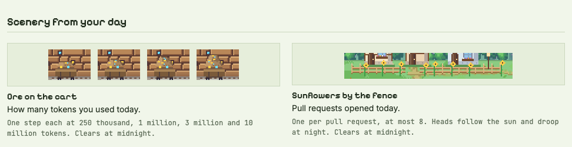
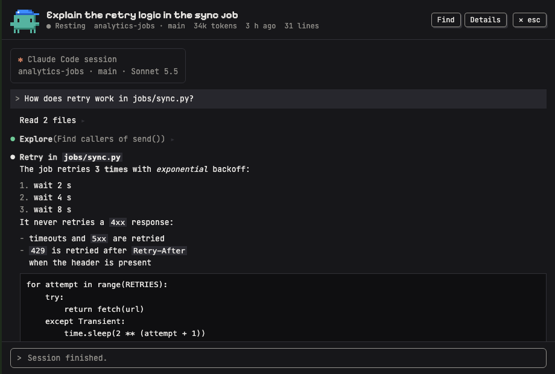

# Session Desk

Session Desk is a local web page that shows your Claude Code sessions as a small pixel-art garden.
Sessions that wait for you stand in the meadow, and sessions that are working dig in the mine.
Click one to answer it in the real `claude` CLI inside the page, or to read its whole transcript.


## Requirements

- macOS or Linux. The Terminal tab needs a pseudo-terminal, so on Windows use WSL.
- Python 3.9 or newer. Nothing to install: the server uses the standard library only.
- The Claude Code CLI, installed and logged in, so `claude` works in your terminal. Run it at least once, so `~/.claude` holds sessions. Without the CLI the page still lists sessions, but terminals and quick replies are off.
- A folder you can write. The app keeps its own files next to `server.py`. If that folder is read-only, set `DESK_STATE_DIR` (see [Settings](#settings)).
- Internet is optional. Without it the page uses system fonts and the sky follows the clock only.

## Run

Get the code, then start the server from its folder:

```bash
git clone https://github.com/omerkemeny/session-desk.git
cd session-desk
python3 server.py
```

No git? Use GitHub's **Code > Download ZIP**, unzip, and run `python3 server.py` in that folder.

It prints the address, for example `Session Desk: http://127.0.0.1:8765  (Ctrl+C to stop; page terminals keep running)`.
Open that address in your browser. Ctrl+C stops the server.
Page terminals keep running in a small terminal host and come back when the server starts again.

To run it in the background instead:

```bash
python3 server.py start           # start in the background; prints the address, the log file and "preparing the session list…" while the first list is built
python3 server.py status          # is it running, where, and how many page terminals
python3 server.py restart         # stop and start again in the background, on the same port; safe from a page terminal
python3 server.py stop            # stop the server; page terminals keep running
python3 server.py stop-terminals  # end every page terminal and the terminal host
python3 server.py doctor          # check the setup and say what to fix
python3 server.py logs            # the last lines of the server and terminal-host logs (logs -n N for N lines)
python3 server.py status --json   # the status as one JSON line, for scripts
```

`python3 server.py --stop-terminals` is the same as `stop-terminals`.
`status` also prints the first thing to fix, if any, and says "run `python3 server.py restart` to load it" when the code on disk is newer than the running server.
`restart` also replaces a server you started in the foreground: that one prints "Session Desk stopped." and the new one runs in the background.
The pid and log files live in the `.desk-run/` folder next to `server.py`.

One server runs per app folder and data folder.
A second `python3 server.py` prints the running copy's address and exits.

`doctor` reads only. It prints one line per check, marked `ok`, `warn` (the app runs, one part is off) or `FAIL` (fix it first), and each line says what to do.
When this folder's server runs, the port check looks at that server's port, so `doctor` works beside a running server.
It exits with code 1 when any line says `FAIL`.

### What a first run shows

When something is missing, the server prints the first thing to do under the address.
For example, on a computer where `claude` has never run:

```
Session Desk: http://127.0.0.1:8765  (Ctrl+C to stop; page terminals keep running)
  No Claude Code data found: run `claude` once, then reload.
```

Do what the line says, then reload the page. What the page shows depends on the case:

- **No data folder, or one you may not read:** the lists and the garden's note show the same sentence as the terminal.
- **No `claude` command:** with sessions listed, a line under the search box says ``Terminals and quick replies are off: The `claude` command was not found: install Claude Code or set DESK_CLAUDE_BIN.``
  The Terminal tab says the same sentence, and the reply box says it after "Quick replies are off:".
- **A read-only app folder:** with sessions listed, the line under the search box says `Page terminals are off: This folder is read-only: start with DESK_STATE_DIR=<a folder you can write>.`
- **Claude Code set up but no sessions yet:** the garden is empty and the lists say "No agent is working right now." and "No finished session here." That is expected: run `claude` in a project folder, then reload.

Each line in the page ends with ``Run `python3 server.py doctor` to check the setup.``
Every place says the same sentence for the same problem: the server's start line, `start`, `restart`, `status`, `doctor`, the page, the Terminal tab and the reply box; only the words before it name what is off.
`doctor` ends the sentence with what to run instead of "then reload", for example ``No Claude Code data found: run `claude` once, then run `python3 server.py doctor` again.``

## What the garden shows

The garden answers four questions at a glance. The Legend page in the app shows every picture with its exact rule: open the Stats panel and click "Legend" at its foot.



**Who needs me.** Each session that waits for your answer is a character in the meadow with a name tag and a "?" bubble.
A red "!" bubble means its last step failed. The sign counts everyone who waits, and the browser tab's title shows the count, for example "(3) Session Desk".
Hover or focus a character for its title, your latest request, its last reply and how long it has waited. Click it to open the session.

**Who is working.** Working sessions are miners at the boulders on the right, and the lantern at the mine mouth burns while any of them works.
When more sessions work than the mine has room for, a "+N" plaque under the mine door counts the rest. The Working list below the garden names them all.
Small half-size characters beside a session are its subagents.
A paper note on the mine's door post marks a session that is out of step: open in two places, behind, or diverged (see [One session, two places](#one-session-two-places)).

**How old is this wait.** A fresh wait has a yellow "?" bubble. Later the character sits on a stump, then naps.
A wait of a day or more naps under a grey-blue blanket and fades, so the newest waits stand out.

**What happened today.** Ore piles up on the mine cart as you use tokens, a sunflower comes up by the fence for each pull request, and paper boats float down the stream for automated runs.
After a big day a comet shows at night. All of it clears at midnight.
The Stats button opens your numbers for today, 7 days, 30 days or all time, with a "Today in the garden" card that explains the scenery.


The sky follows the real sun, moon, stars and weather of one city (Tel Aviv unless you change it, see [the guide](docs/guide.md#how-to-change-the-city)).
Below the garden, the Working and Resting lists hold every recent session, with a search box and small badges.

## The sidebar

Click a character or a list row to open the sidebar.

**Terminal tab.** The real `claude --resume` for that session, running on your computer.
Approval prompts, Esc, Ctrl+C and slash commands work as in any terminal, because every key goes to the CLI.
To move focus out with the keyboard, press F6 or Ctrl+Shift+← (Shift+F6 goes to the footer). F6 takes you back in.
Closing the sidebar keeps the terminal running, and "End terminal" stops it.
The first time the CLI runs in a folder it asks whether you trust the folder. Answer it in the Terminal tab; the app never answers for you.

**Transcript tab.** The whole session as the CLI shows it: prompts, replies, tool calls, interrupts and compactions.
Reads, searches and shell commands fold into one line in the CLI's words, such as "Read 2 files". Click a line, or press Enter on it, to read its result in place.
The Details switch in the header shows every call and result at once.
Find in the header (or `/`) searches the whole session, including results the CLI hides; Enter and Shift+Enter step through the matches.
Long sessions open at the newest part, and "Show earlier" loads more.
At the bottom is a quick-reply box: Enter sends, Shift+Enter adds a line.



A quick reply runs the CLI without a terminal, so a tool call that needs your approval is refused. Use the Terminal tab for those.
The box is also off while the session works, while it is open in another program, and for automated runs; it says why.
When a reply fails, the CLI's own message shows under "The reply could not run".

## One session, two places

A session can be open in the page and also in the Claude desktop app or another terminal.
Those are two copies, and neither sees what you type in the other.
The list row's "open twice" badge and the note on the mine door appear only while two or more live programs hold the session, for example the page terminal and the desktop app.

- The sidebar warns you, for example "Also open in desktop app."
- When the other copy wrote newer messages, the sidebar says "Newer messages were written elsewhere." Press **Reload terminal** to restart the page terminal on the newest state.

Type in one place per session.

## Safety and privacy

- **Local only.** The server listens on 127.0.0.1, so other computers cannot reach it. It answers only requests addressed to 127.0.0.1 or localhost.
- **Only this page can type.** Anything that writes (a reply, keys into a terminal) needs a secret token made at each start, plus a same-page check. Another website open in your browser cannot type into your sessions.
- **What it reads.** Your Claude Code data folder (`~/.claude`, or `DESK_CLAUDE_DIR`). It never writes there; changes to sessions happen only through the `claude` CLI.
- **What it writes, and where.** Only its own files, in the app folder (or `DESK_STATE_DIR`):
  - `.stats-cache.json` holds the Stats counts and ids, never message text.
  - `.stats-cache-summaries.json` holds the short session titles and texts the lists show, so a restart is fast.
  - `.desk-run/` holds the pid, the logs and the terminal host's socket, readable by you only.

  With `DESK_CLAUDE_DIR` set, the names carry a short code for that folder, for example `.stats-cache-<code>.json` and `.desk-run-<code>/`.
  You can delete the caches at any time; they are rebuilt. Do not send them to anyone: they describe your usage.
  The page keeps a few choices in your browser only: each session's look, which sessions you sent home, the chosen Stats period and whether the automated runs are unfolded.
- **Two outside requests.** The page loads fonts from Google Fonts and asks Open-Meteo for the weather, sending only the city's position. Neither learns anything about your sessions. The `claude` CLI talks to its own service as it always does.
- **Be careful with the port and with pictures.** Transcripts can hold secrets such as keys, passwords or customer data. Never forward the port to a network, and think twice before sharing a screenshot of real sessions.
- **SessionEnd hooks.** If you have one, it runs after every quick reply and whenever a page terminal ends or reloads, because each of those is a CLI run ending.

## Settings

Set these as environment variables when you start the server, for example `PORT=9000 python3 server.py`.

| Variable | Default | What it does |
|---|---|---|
| `PORT` | `8765` | Port on 127.0.0.1. `0` picks a free port and prints it. |
| `DESK_CLAUDE_DIR` | `~/.claude` | Folder the sessions are read from. |
| `DESK_CLAUDE_BIN` | `claude` on your PATH, else `~/.local/bin/claude` | The CLI used for terminals and quick replies. |
| `DESK_STATE_DIR` | the app folder | Where the app writes its own files. Set it to a folder you can write when the app folder is read-only. |
| `DESK_TERMHOST` | `1` | `0` makes page terminals children of the server, so they end when it stops. |
| `DESK_TERMHOST_IDLE` | `300` | Seconds a terminal host with no terminals and no server waits before it exits. |
| `DESK_WATCH` | `1` | `0` turns off the system's file notifications; the server then looks for changes on a timer, and `fds.watches` in `/api/health` stays 0. |
| `DESK_DEBUG` | off | `1` prints the full error in the terminal instead of the one-line message. |
| `DESK_TRACEMALLOC` | off | `1` adds `memTop` (the largest memory users) to `/api/health`. It slows the server a little. |
| `DESK_DETACHED` | not set | Set by `python3 server.py start` for the background server. Do not set it yourself. |
| `XDG_RUNTIME_DIR` | set by the system | Where the terminal host's socket goes when the app folder's path is too long for one. Without it, the system's temp folder. |
| `CLAUDECODE` | set by Claude Code | When you start the server from inside a Claude Code session, the CLI it runs does not inherit that session's `CLAUDE*` and `ANTHROPIC*` variables. |

## Troubleshooting

The first step for anything is `python3 server.py doctor`. It reads only and says what to fix.

| What you see | What it means | What to do |
|---|---|---|
| ``No Claude Code data found: run `claude` once, then reload.`` | There is no `~/.claude` yet. | Run `claude` once and log in, then reload. If your data lives elsewhere, set `DESK_CLAUDE_DIR`. |
| ``No Claude Code sessions yet: run `claude` in a project folder, then reload.`` | The data folder is there but holds no session. | Do what it says. |
| `The Claude Code data folder cannot be read: check its permissions, then reload.` | The data folder exists, but you may not read it. | Fix its permissions. |
| ``The `claude` command was not found: install Claude Code or set DESK_CLAUDE_BIN.`` from the server, `status` and `doctor`; the same sentence after ``Terminals and quick replies are off: `` under the search box and in the Terminal tab, and after ``Quick replies are off: `` in the reply box | The CLI is not on your PATH. | Install Claude Code, or set `DESK_CLAUDE_BIN` to its path. A newly installed `claude` on your PATH is found without a restart. |
| ``The `claude` command cannot be run: reinstall Claude Code or set DESK_CLAUDE_BIN.`` (with the same lead-ins) | The file is there but is not a program you may run. | Reinstall Claude Code, or set `DESK_CLAUDE_BIN` to the right file. |
| `This folder is read-only: start with DESK_STATE_DIR=<a folder you can write>.` from `doctor` and `status`; after `Page terminals are off: ` in the page and the Terminal tab; after `Page terminals are off and caches last for this run only: ` from `python3 server.py` | The app cannot write in its folder. The foreground server still runs, with page terminals off and caches kept for this run only. | Start with `DESK_STATE_DIR=<a folder you can write> python3 server.py`. |
| ``Session Desk cannot run in the background here (`python3 server.py` in the foreground runs with page terminals off): This folder is read-only: start with DESK_STATE_DIR=<a folder you can write>.`` from `start` or `restart` | The same; a background server needs a folder it can write. | The same, or run in the foreground. |
| `Session Desk already runs for this data folder: pid N, http://127.0.0.1:PORT` | A server for this app folder and data folder is running, on any port. | Open that address, or stop it with `python3 server.py stop`. |
| `already running: pid N, http://127.0.0.1:PORT` after `start` | The same, from `start`. | The same. |
| `Session Desk: port N is in use by another program; start on another port, for example PORT=9000 python3 server.py` | Another program holds the port. | Start on another port: `PORT=9000 python3 server.py`. |
| `Session Desk needs Python 3.9 or newer; this is 3.8` | The Python is too old. | Run it with a newer Python. |
| `Session Desk: PORT must be a number from 0 to 65535, not 'abc'` | `PORT` is set to something that is not a port. | Set a number, for example `PORT=9000`, or unset it. |
| `Session Desk stopped: ...` | The server hit an unexpected error. The line names the error and the file with the details. | Read that file, or run with `DESK_DEBUG=1` to see the details in the terminal. |
| `server did not start (exit N); last lines of ...` after `start` | The background server ended at once. | Read the lines it prints; `python3 server.py doctor` names the cause. |
| "offline · retrying" beside the title | The server is not answering (stopped or restarting). | Nothing, if you are restarting it. The page returns to "live" by itself, and open terminals re-attach. |
| "live · polling" beside the title | The change feed dropped; the page asks for news every few seconds. | Nothing. It returns to "live" when the feed is back. |
| "updated · reload" beside the title | The app's files changed on disk since the page loaded. It shows within a minute or so. | Click it to reload. |
| "demo · example data" beside the title and "Loading sessions…" that never ends | You opened `web/index.html` as a file instead of through the server. | Open the address the server printed. |
| `bad token, reload the page` | The server restarted, so the page's token is old. | Reload the page. |
| `terminal host speaks protocol N, this server M; ...` | A terminal host from another version still runs. | `python3 server.py stop-terminals` (it ends the open page terminals), then open the terminal again. |
| ``terminal host is newer than this server; run `python3 server.py restart` `` in `status` | The server runs older code than the terminal host. | `python3 server.py restart`. |
| "Terminal host stopped. Open the Terminal tab again to start a new terminal." | The terminal host ended. | Open the Terminal tab again. |
| Titles or numbers missing after a Claude Code update | The CLI's session files changed shape. Open `/api/health` on the server's address: `formatWarnings` lists what looks different, and `formatNotes` lists records it does not know but can skip. | Wait for an app update; nothing is lost. See [after a Claude Code update](docs/guide.md#after-a-claude-code-update). |
| Something else looks wrong | | Open `/api/health` on the server's address. It shows counts and file names only, never message text. Its fields are described in [docs/api.md](docs/api.md#get-apihealth). |

## Read more

- The **Legend** page in the app: every picture, its meaning and its exact rule. It is drawn by the app's own code, so it is always current.
- [docs/guide.md](docs/guide.md): the longer user guide, in the same order as the Legend.
- [docs/api.md](docs/api.md): every field the server answers with, including `/api/health`.

## License

MIT, see [LICENSE](LICENSE). Session Desk is an independent project and is not affiliated with or endorsed by Anthropic; Claude and Claude Code are Anthropic's products.
